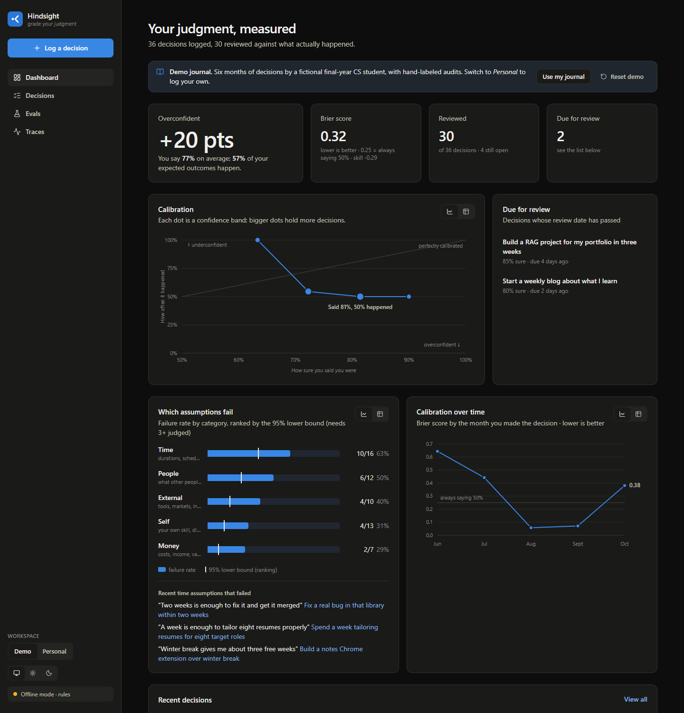
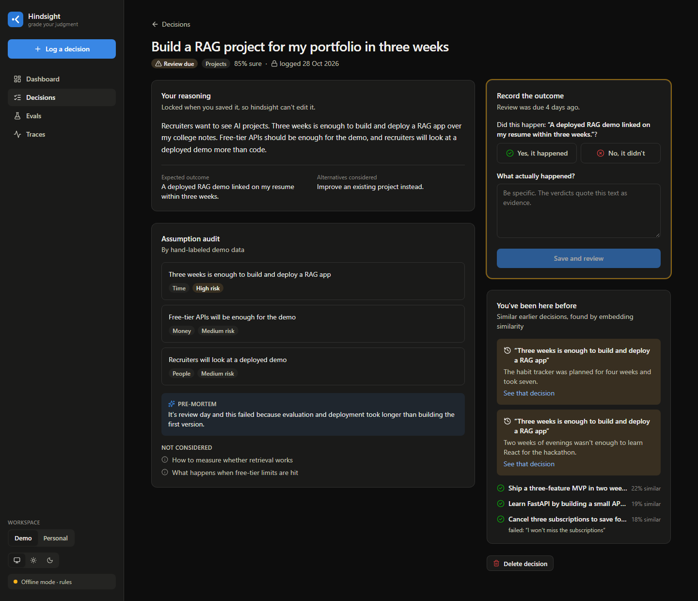
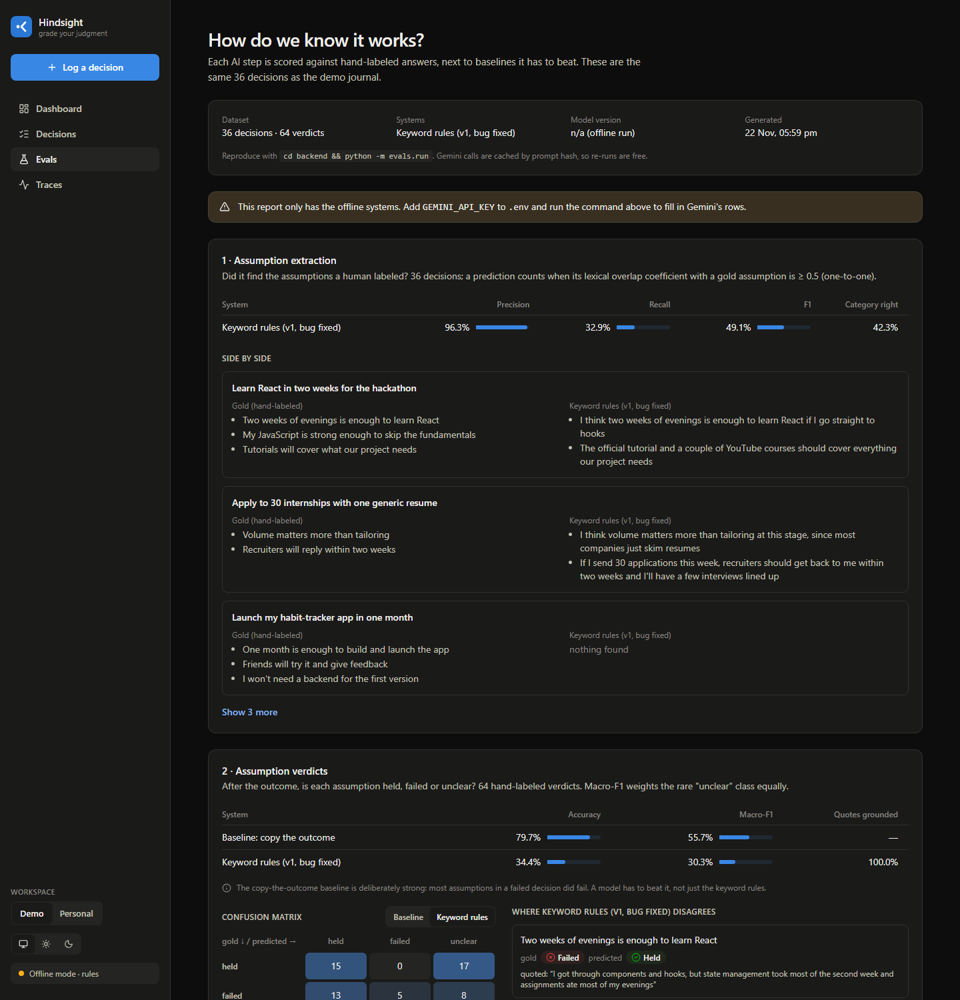
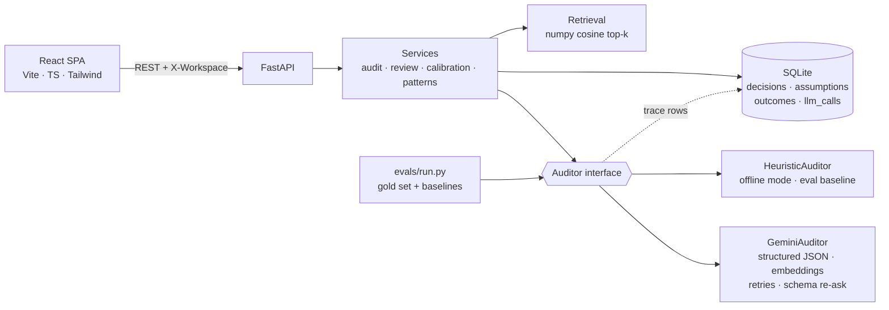

# Hindsight

**A decision journal that grades your judgment.** Log a decision with your reasoning and how sure you are. An LLM pulls out the assumptions it quietly depends on. When the outcome arrives, Hindsight judges which assumptions held, quoting your own notes as evidence, and scores how well calibrated your confidence was.

[](https://github.com/5nss/ai-decision-tracker/actions/workflows/ci.yml)
   



## Why

People rarely learn from decisions: they forget why they made them, and hindsight bias rewrites the memory ("I knew it wouldn't work"). Hindsight locks the reasoning at decision time and turns judgment into something you can measure:

- **Calibration.** Every decision is a forecast ("I'm 80% sure this happens"). Reviews resolve it, so you get a Brier score and a reliability diagram. The demo journal's headline: *when this person says 80%, it happens 50% of the time.*
- **Assumption failure patterns.** Assumptions are categorized (time, people, money…) and judged after the fact, then ranked by a Wilson lower bound: *time assumptions fail 63% of the time (10 of 16).*

## What it does

| | |
|---|---|
| **Audit at decision time** | Gemini returns schema-constrained JSON: 2–5 assumptions (category and risk), what the reasoning ignores, and a one-line pre-mortem. |
| **"You've assumed this before"** | Each decision is embedded. Cosine top-k over *earlier, reviewed* decisions finds similar cases, and the audit cites the assumptions that failed in them (citations are checked against what the model was actually shown). |
| **Review with evidence** | After the outcome, every assumption is judged held / failed / unclear with a verbatim quote. A grounding check flags quotes that aren't really in your notes. |
| **Calibration and patterns** | Brier score, skill vs. your own base rate, reliability bins, monthly trend, and failure rate per category with 95% Wilson bounds, all computed on read from the rows. |
| **Evals and traces in the product** | The **Evals** page shows how each AI step scores against hand-labeled data and baselines. The **Traces** page shows every model call's latency, retries, tokens and errors. |
| **Works with no API key** | Offline mode swaps in a rule-based auditor and hashing embeddings behind the same interface. It's also the eval baseline. |

<p align="center">
  
  
</p>

## How do we know it works?

`python -m evals.run` scores each AI step against **36 hand-labeled decisions** (64 judged assumptions, 10 retrieval themes). That's the same journal that seeds the demo, and every gold evidence quote is checked by a test. Each system is compared with baselines it has to beat:

<!-- evals:start -->
**Assumption verdicts**: held / failed / unclear, 64 gold labels

| System | Accuracy | Macro-F1 |
|---|---|---|
| Baseline: copy the outcome's polarity to every assumption | 79.7% | 55.7% |
| Keyword rules (v1's approach, substring bug fixed) | 34.4% | 30.3% |
| Gemini | *run `python -m evals.run` with a key* | |

**Similar-decision retrieval**: recall@3, relevant = same theme

| Method | Recall@3 | MRR |
|---|---|---|
| v1 rule: same domain, most recent | 43.3% | 0.549 |
| TF-IDF (lexical) | 73.3% | 0.746 |
| Hashing embeddings (offline mode) | 48.3% | 0.692 |
| Gemini `gemini-embedding-001` | *run with a key* | |

**Assumption extraction**: keyword rules get 96% precision but only 33% recall, because they only see assumptions phrased with cue words like "should" or "expect".
<!-- evals:end -->

Two findings drove design decisions:
1. **v1's keyword approach loses to a trivial baseline.** Copying the outcome's polarity onto every assumption already gets 80%, so that's the bar an LLM judge has to clear, not 34%.
2. **The offline embedding threshold comes from data.** The retrieval eval finds the cosine cut-off that best separates same-theme pairs (0.17 for hashing embeddings), and the app uses it as its "similar decision" threshold.

The full report, with the confusion matrix, per-case side-by-sides and error analysis, is on the Evals page and in [`backend/evals/results/latest.md`](backend/evals/results/latest.md).

## Architecture



**One request, end to end.** `POST /api/decisions` validates the input, then saves the decision with a server timestamp and commits before any model call. It then embeds the text, commits, retrieves similar reviewed decisions, and calls `audit()` with no write lock held. It saves the assumptions and flushes buffered trace rows. If the model fails after retries, the decision is still saved with `audit_status="failed"` and a retry button. More in [DESIGN.md](DESIGN.md).

## Design decisions

- **No vector database.** A few hundred decisions × 768 floats is under 1 MB, and one numpy matmul takes milliseconds. Revisit at around 100k rows.
- **Immutable reasoning.** There's no edit endpoint. `extra="forbid"` rejects a client-sent `created_at`, and re-auditing after a review is a 409, because extracting assumptions once you know the outcome is exactly hindsight bias.
- **Failures are states, not swallowed exceptions.** Retries use exponential backoff on 429, 5xx and timeouts, with one re-ask on schema-invalid JSON. Then the call fails visibly, is traced, and can be retried.
- **Commit before the network call.** SQLite has one writer. The request never holds a write lock while waiting on Gemini, and trace rows are buffered and written at the end.
- **Wilson lower bound for rankings.** It ranks "4 of 5 failed" above "1 of 1 failed".
- **The model is config.** `gemini-flash-latest` is the default. Traces and eval reports record the exact `model_version` returned.
- **Same interface for offline and online.** That makes the eval baseline an apples-to-apples comparison and the app usable with no key.

## Run it locally

Needs Python 3.11+ and Node 20+.

```bash
# 1. backend
cd backend
python -m venv .venv
source .venv/bin/activate            # Windows: .venv\Scripts\activate
pip install -e ".[dev]"

# 2. frontend (built once, then served by FastAPI)
cd ../frontend && npm ci && npm run build

# 3. optional: live Gemini audits
cd .. && cp .env.example .env        # then set GEMINI_API_KEY

# 4. run
cd backend && uvicorn hindsight.main:create_app --factory --port 8000
```

Open http://localhost:8000. The demo journal is seeded on first start. Switch to **Personal** in the sidebar to log your own decisions. For UI work, run `npm run dev` in `frontend/` (port 5173, proxies `/api`).

**Docker:** `docker build -t hindsight . && docker run -p 8000:8000 --env-file .env hindsight`

## Tests and evals

```bash
cd backend
pytest                                  # 55 tests, no network (Gemini is a scripted fake)
python -m evals.run                     # heuristic + Gemini if GEMINI_API_KEY is set
python -m evals.run --systems heuristic --tasks retrieval   # a single slice
```

CI runs lint, tests, the offline evals, the frontend type-check and build, and a Docker build that boots the image and checks the API.

## Project structure

```
backend/
  hindsight/
    ai/          Auditor interface, GeminiAuditor, HeuristicAuditor, prompts, schemas
    api/         decisions, insights, system (health, traces, evals, demo reset)
    services/    audit, review, retrieval, calibration, patterns
    seed/        demo_journal.json: the demo data and the eval gold set
    models.py    SQLAlchemy 2.0 models · schemas.py: API contracts
  evals/         run.py, metrics.py, baselines.py, results/latest.{json,md}
  tests/         API, Gemini retry/schema handling, math, retrieval, data integrity
frontend/src/
  pages/         Dashboard, Decisions, NewDecision, DecisionDetail, Evals, Traces
  components/    UI kit, hand-written SVG charts (reliability, trend, pattern bars)
```

## What changed from v1

v1 was a one-day prototype. Its spec promised RAG, memory layers and validation experiments, but the code didn't implement them. v2 keeps the core idea, *a thinking audit, not a journal*, and rebuilds the rest:

| | v1 | v2 |
|---|---|---|
| Judging outcomes | Word overlap plus substring negation ("another" counted as "not") | Per-assumption verdicts with verbatim evidence and a grounding check |
| Retrieval | None (the similarity helper was dead code) | Embeddings, top-k with an eval-tuned threshold, no future leakage |
| "Confidence" | `frequency / total` (3 of 3 = 100%) | Brier score, skill score, Wilson bounds |
| LLM output | One prompt over 15 rows asking for a 1–10 score | Schema-constrained JSON, retries, traced |
| Errors | `except Exception: pass` | Failed state, retry, visible in traces |
| Integrity | Clients could backdate entries | Server timestamps, immutable reasoning |
| Quality | No tests | 55 tests, 3 evals with baselines, CI, Docker |

## Roadmap

- Public demo deployment
- LLM-judge matching for the extraction eval, validated against hand checks
- Postgres + Alembic for multi-user accounts
- Email reminders on review dates
